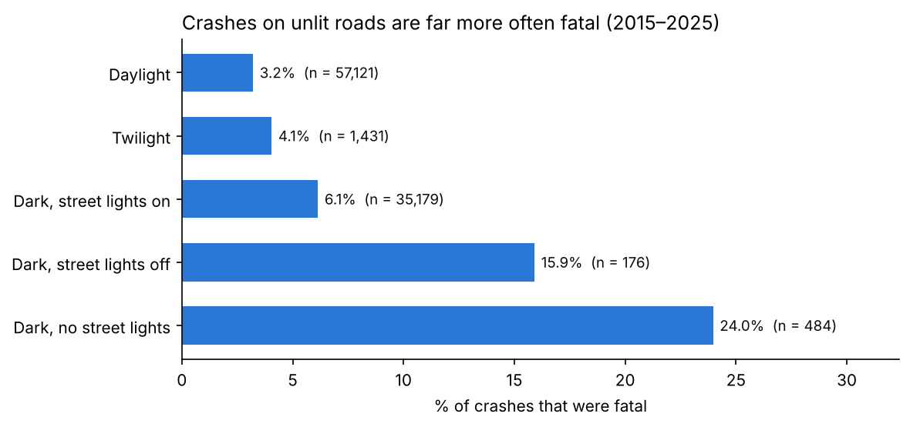
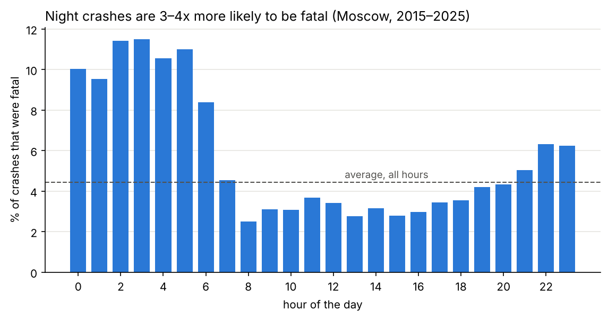
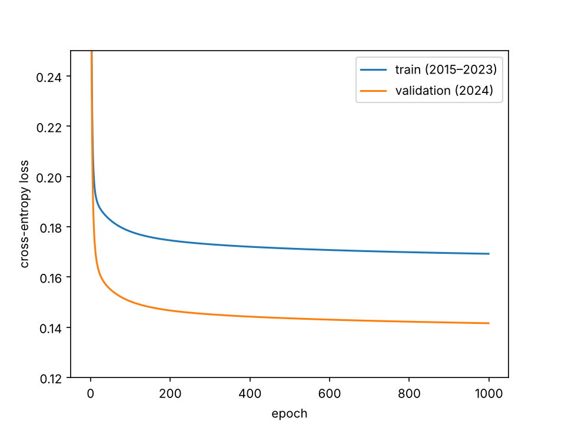
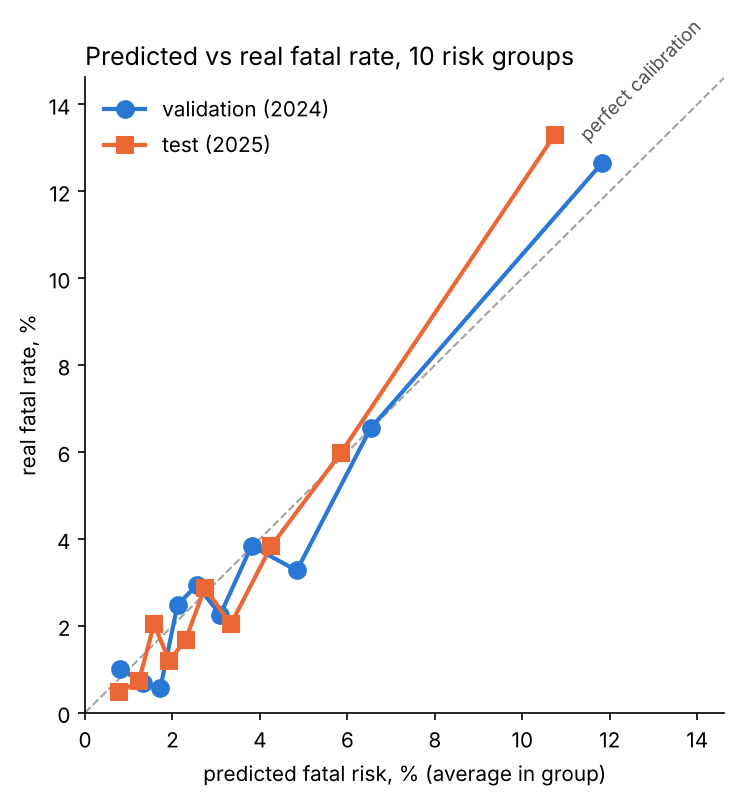

# Which road crashes in Moscow turn deadly?

**In 30 seconds:** I took 94,786 Moscow road crashes in which someone was injured or killed (2015–2025) and built a model that estimates how likely a crash is to be fatal. It only uses conditions known at the moment of the crash: time, lighting, weather, road, crash type and who was involved. The model is logistic regression written from scratch in NumPy. I tested it on 2025, a year it never saw during training:

- **The 10% of crashes it rated most dangerous were 13.3% fatal (vs 3.4% overall) and contained 39% of all deadly crashes.**
- **At night, crashes on roads without street lighting were 24% fatal, vs 6% on lit roads. Even after accounting for time, crash type, location and who was involved, the odds of death on unlit roads stay about 2x higher.**



---

## Why I built this

✏️ *(Write 2–3 sentences in your own words: why this problem matters to you.)*

## Data

- **Source:** [dtp-stat.ru](https://dtp-stat.ru/opendata/) open data, built from official traffic police (GIBDD) records
- **Moscow:** 94,786 crashes with injured or killed people, January 2015 – February 2026
- Only crashes with victims are recorded. So the question is *"given a crash, how likely is it to be fatal?"*, not *"where do crashes happen?"*
- The raw data is not in this repo. Download `moskva.geojson` from the link above into `data/moskva.geojson/`



## Approach

1. **Target:** `fatal` = 1 if at least one person died (4.4% of crashes). Death is unambiguous; "severe vs light injury" depends on how injuries are classified.
2. **Features (260, almost all 0/1):**
   - hour, weekday, month
   - lighting, crash type, district
   - weather, road conditions, nearby objects, participant types (pedestrians, motorcyclists, children…)
   - number of participants
   - Values seen fewer than 100 times in training were merged or dropped; one column that was the same in every crash was removed.
   - **Leakage avoided:** death and injury counts and health status are never used as features.
3. **Split by time**, so the model is always tested on the future. Every choice (rare values, columns, scaling) was made on train only.
   | Set | Years | Crashes | Fatal |
   |---|---|---|---|
   | Train | 2015–2023 | 77,181 | 4.65% |
   | Validation | 2024 | 8,859 | 3.62% |
   | Test (used once) | 2025 | 8,352 | 3.41% |
4. **Model:** logistic regression from scratch in NumPy ([`src/logreg.py`](src/logreg.py)):
   - sigmoid, binary cross-entropy loss, analytic gradient
   - full-batch gradient descent (learning rate 0.5, 1000 epochs)
   - functions unit-tested against values computed by hand
   - **gradient check:** the analytic gradient matches a numerical estimate (nudging each weight by ±ε) to a relative error of 5·10⁻¹⁰
5. **Evaluation:**
   - compared against a baseline that gives every crash the training fatality rate
   - scikit-learn is used **only** to compute ROC-AUC



## Results

| | Validation (2024) | Test (2025) |
|---|---|---|
| Log loss: model | 0.1416 | **0.1336** |
| Log loss: baseline | 0.1571 | 0.1507 |
| ROC-AUC (0.5 = random) | 0.739 | **0.754** |
| Fatal rate, all crashes | 3.6% | 3.4% |
| Fatal rate, model's top 10% | 12.7% | **13.3%** |
| Share of all deaths in top 10% | 34.9% | **38.9%** |

### Are the probabilities right?



Fatal crashes became rarer over time (4.65% → 3.41%), so I expected a model trained on older years to predict too high. It mostly didn't: the model has no "year" feature, yet its average prediction is 3.47% for 2025 (real: 3.41%). The kinds of crashes it links to deaths simply became less common. The riskiest group is somewhat under-predicted (10.7% predicted vs 13.3% real), and each group holds only ~25–30 fatal crashes, so the points are noisy.

### What is linked to deadly crashes

Odds ratio = e^weight: x1.8 means 1.8 times the odds of a death. Correlation, not causation.

**Yes/no flags** (compared with the flag being absent):

| Feature | Odds |
|---|---|
| Pedestrians involved | x1.80 |
| Motorcyclists involved | x1.72 |

**Groups** (only comparisons inside the same group are meaningful):

| Group | Higher risk | Lower risk |
|---|---|---|
| Lighting | dark, no street lights x1.35 | dark, street lights on x0.68 · daylight x0.41 |
| Crash type | hitting an obstacle x1.48 | collision between vehicles x0.40 · passenger falling x0.54 |
| Hour | 0–6 am x1.22–1.30 | daytime hours |

Unlit vs lit roads at night: 1.35 / 0.68 ≈ **2x the odds**. Raw numbers show a much bigger gap (24% vs 6% fatal, about 5x the odds). After accounting for the other features it shrinks to about 2x, so part of the raw gap comes from other factors, such as when, where and what kind of crash happened.

## The math

<!-- ✏️ Rewrite this section in your own words once you can explain each step without looking. -->

For each crash the model computes a **score** `z = w·x + b`: every feature that is "on" adds its weight `w`, and `b` is the base level.
The **sigmoid** `p = 1 / (1 + e^(−z))` squeezes the score into a probability between 0 and 1.

The **loss** `L = −(1/n) Σ [ y·ln p + (1−y)·ln(1−p) ]` measures how wrong the predictions are. It is near 0 when the model gives high probability to what really happened, and very large when it is confidently wrong.

To improve, the model needs to know which way to move each weight. Going backwards through the chain rule (loss → probability → score → weight), almost everything cancels and the gradient is simply

```
∂L/∂w = (1/n) · Xᵀ (p − y)
```

`p − y` is each crash's error (prediction minus truth). `Xᵀ` hands each error back to the features that were present in that crash. Gradient descent then steps against the gradient, `w ← w − lr · ∂L/∂w`, and repeats until the loss stops falling.

## Limitations

- **Correlation, not causation.** Unlit roads may also be faster or more rural, so lighting may not be the cause.
- **Important factors are missing:** speed, seatbelts, alcohol, ambulance arrival time. This limits how good any model on this data can be.
- **Few deaths per year** (~285 in 2025), so differences of ~0.01–0.02 in AUC between years are within noise.
- **Not tuned:** learning rate and number of epochs were set once, and training loss was still slowly falling after 1000 epochs.
- Only crashes with victims are recorded, so the model says nothing about how *often* crashes happen in a place.

## How to run

```bash
pip install -r requirements.txt
jupyter notebook
```
Then run, in order:
1. [`notebooks/01_explore.ipynb`](notebooks/01_explore.ipynb): first look at the data, plots of fatal rate by hour and lighting
2. [`notebooks/02_features.ipynb`](notebooks/02_features.ipynb): time split, features, saves `data/features.npz`
3. [`notebooks/03_model.ipynb`](notebooks/03_model.ipynb): tests, gradient check, training, evaluation, calibration

## Structure

```
src/logreg.py          logistic regression from scratch (sigmoid, loss, gradients, training loop, gradient check)
notebooks/             exploration, feature engineering, model
plots/                 figures used in this README
LOG.md                 dated project log with every number
```
